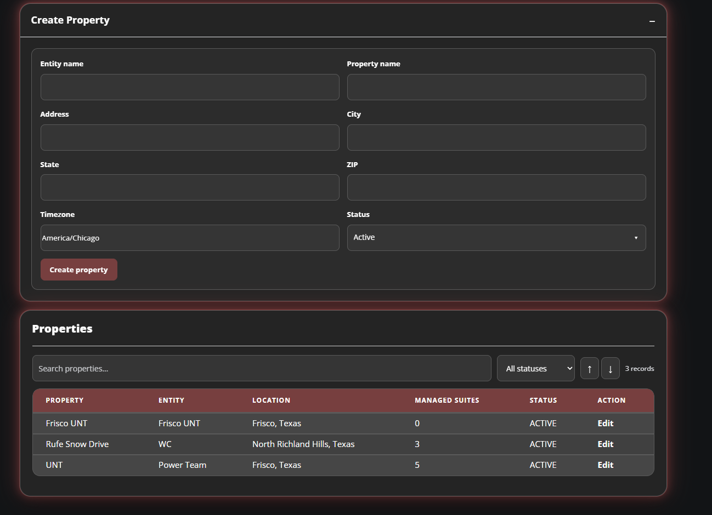
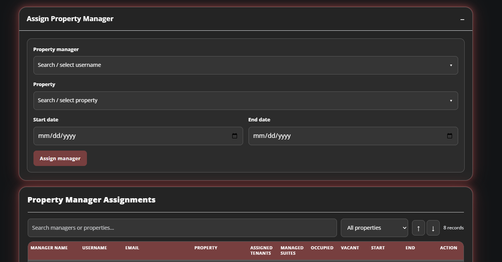
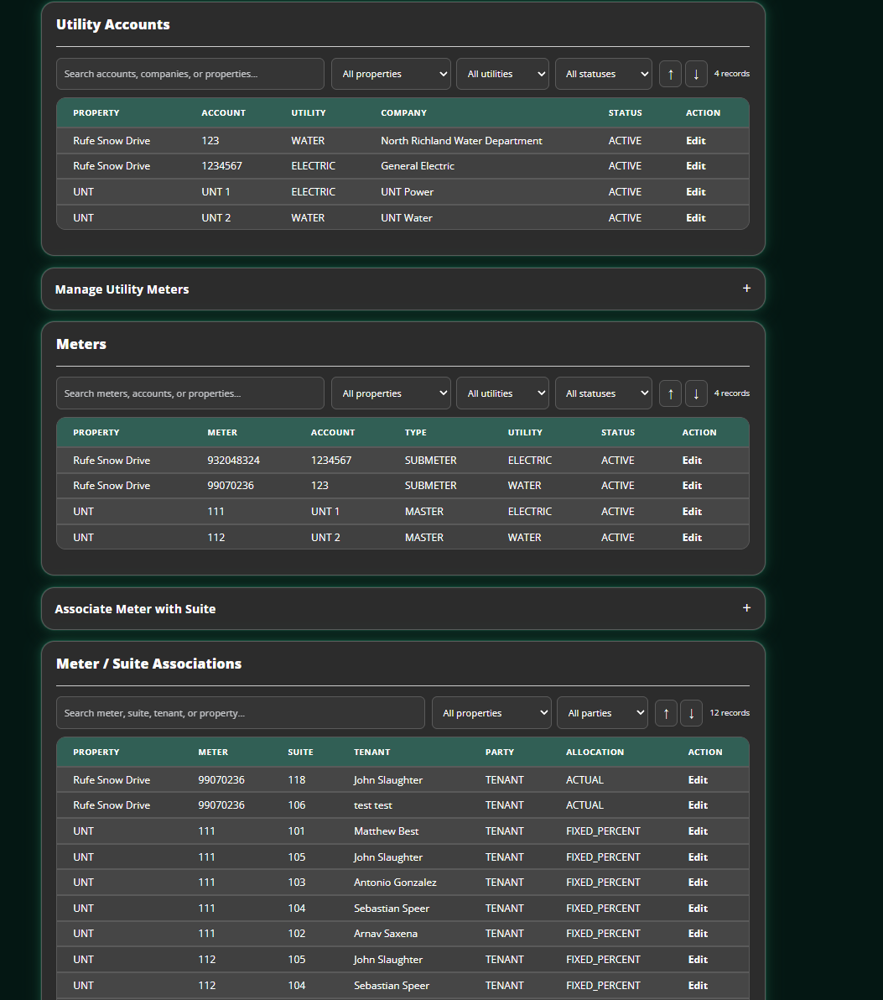
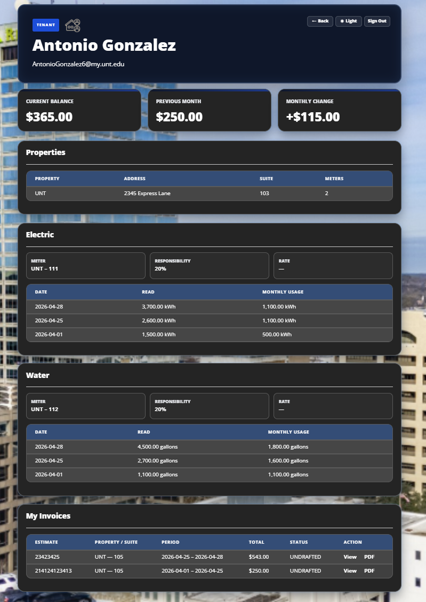
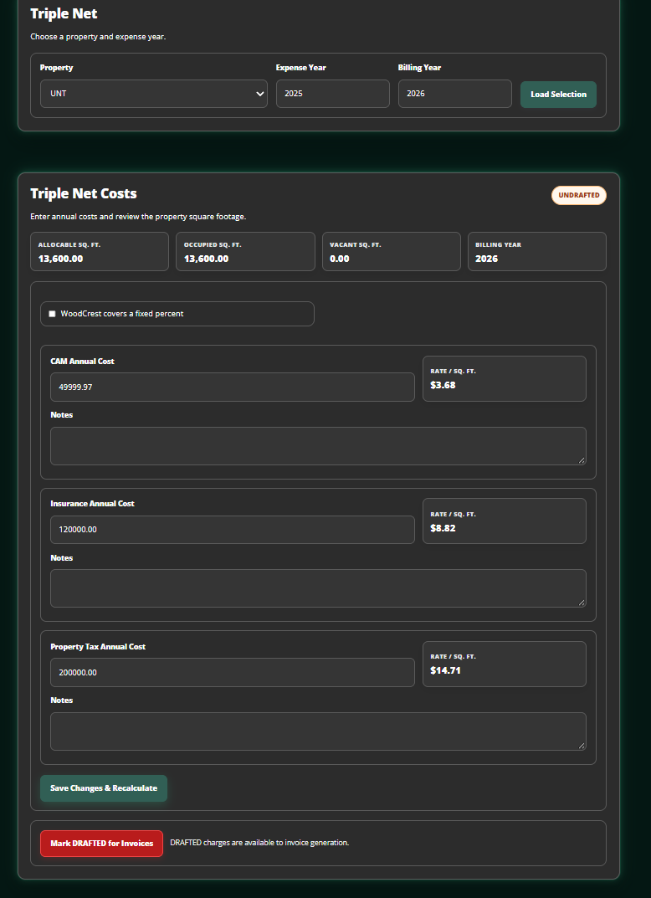
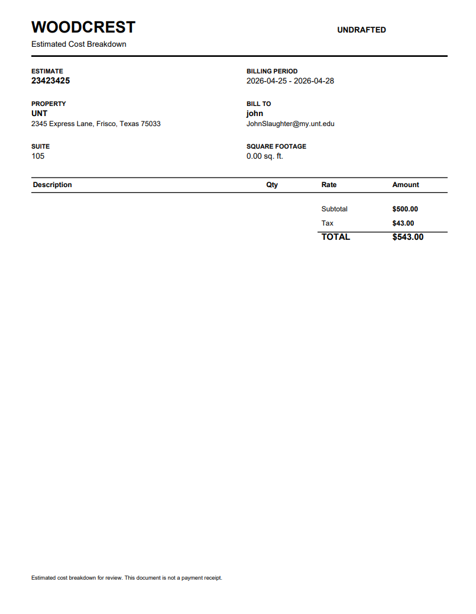

# Utility Billback – User Manual
**Version:** 0.2
**Team Name:** WoodCrest Utilities
**Date:** 10/9/2026
---
## 1. Introduction
This application tracks the water and electricity usage, the charge rates per suite, alongside the property tax, property insurance, and common area maintenance costs and how all three costs are delegated per suite and tenant at each property. This is meant to be scalable for property management firm with dozens to hundreds of properties, for both their own staff and for their tenants to be capable of viewing the relevant 
---
## 2. System Requirements
- **Hardware:** Active Internet Connection
- **Software:** Web browser like Google Chrome or Firefox
- **Other Dependencies:** None

---
## 3. Installation Guide

No installation required, access website at https://billbacks.woodcrestmanagement.com/login_test/.
---
## 4. Getting Started

Open application at link provided in step 3
Enter username and password provided by WoodCrest
Click Sign in
---
## 5. Features & Functions
### Feature 1: Property Management
This feature allows users with administrative privilege to create properties within the webpage’s database and all of the associative suites and utility meters that are needed for a property management firm to track the associated data with tenants should they lease out spaces within a property.  and  .
Access the “create property” function within the Admin User Page.

### Feature 2: Utility Management
This feature allows assigned property managers to track the utility usages and costs at individual properties. They can see the readings and time of readings for every electricity and water meter at a given property, alongside who is responsible for that water and power usage. They can add reading data, along with associating given suites with . Tenants can see the utility usage data associated with their own .
Access “Meters & Utilities” to manage the meters themselves, access “Utility Usage” to manage access the meter readings.
### Feature 3: Triple Net
This feature allows property managers to set the property insurance, property tax, and common areas maintenance costs associated with a given property for the year. This system will then calculate how that cost is distributed between the property owner and their various tenants. .
Access “Triple Net” to see the triple net history and to set the rates for current and future years.
### Feature 4: Invoice Drafts
This feature utilizes the given data on triple net and utilities to determine the monthly combined charges that each tenant would receive from the owner of the property that they’re renting out of. This creates a draft that both the tenant and property managers should be able to view and understand how the charge was determined. Creating the actual invoice is out of scope, this is merely a drafted version that should show an identical cost. .
Access “Invoice” as a property manager or “My Invoices” as a tenant.
---
## 6. Troubleshooting examples
| Page unavailable | Page is blocked until full release | Wait for full release |

---

## 7. Contact Information
- **Support Email:**[contact Email]
- **Website:**[Optional]
- ** Project Repository:**[GitHub/GitLab Link]
- **Other Support Channels:** [Optional]
## 8. FAQ (Optional – Extra Credit)
**Q:** Why are invoice drafts produced?
**A:** The system is built to interact with all of the data involved in calculating the monthly charges, but implementing a billing system was out of scope for the project.

